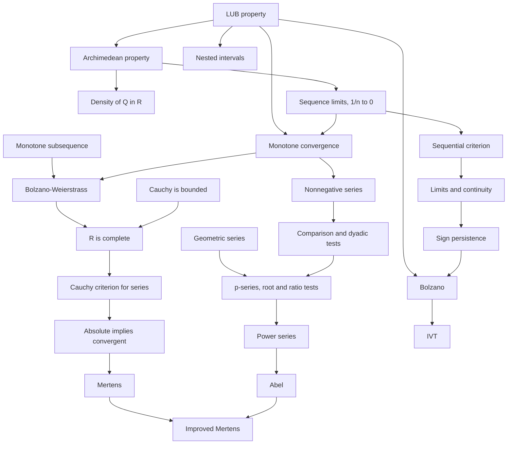

#math 

# MATH 319 Recap: From Well-Ordering to the IVT

Everything up to the midterm (Lectures 1–11, text Ch 1 to §3.2, §2.6, HW5–6), in the order the course built it. One axiom about $\mathbb R$, the least upper bound property, drives almost every theorem. Sequences then become the main tool, first for series and then for limits and continuity.

Definitions are in `info` callouts and theorems in `theorem` callouts. Each ends with **Uses:**, what the result is built from. See also [[content/Notes/Math/Real Analysis/Definitions and Theorems|Definitions and Theorems]] and [[content/Notes/Math/Real Analysis/Midterm Review|Midterm Review]].

## How It Fits Together

Each arrow means "is used to prove".

## 1. Starting Point: $\mathbb N$ and $\mathbb Q$
*[[content/Notes/Math/Real Analysis/Lecture 1|Lecture 1]], [[content/Notes/Math/Real Analysis/Lecture 2|Lecture 2]]*

The course starts with the numbers we already trust, to see exactly what is missing.

> [!info] Axiom 1.4.2 · Well-Ordering Principle
> Every non-empty subset of $\mathbb N$ has a least element.

> [!theorem] Theorem 1.4.4 · Induction
> Let $P(n)$ be a statement for each $n\in\mathbb N$. If $P(1)$ is true, and $P(k)\implies P(k+1)$ for every $k\in\mathbb N$, then $P(n)$ is true for all $n\in\mathbb N$.
>
> **Uses:** well-ordering. Induction and well-ordering are equivalent.

> [!theorem] Theorems 1.4.10–1.4.14 · $\mathbb Q$ is an Archimedean Ordered Field, Dense in Itself
> - $+$, $\times$ and $<$ on $\mathbb Q$ satisfy the usual field and order rules.
> - If $x<y$ in $\mathbb Q$, then $z=\frac{x+y}{2}\in\mathbb Q$ satisfies $x<z<y$.
> - For positive rationals $x,y$ there is $n\in\mathbb N$ with $nx>y$.

**The hole.** No rational $q$ has $q^2=2$. So $\{ q\in\mathbb Q:q>0,\ q^2<2 \}$ is bounded above in $\mathbb Q$ but has no least upper bound in $\mathbb Q$. Every later theorem that produces a number out of nothing (a sup, a limit, a root from the IVT) fails in $\mathbb Q$ for this reason.

## 2. The Reals and the LUB Property
*[[content/Notes/Math/Real Analysis/Lecture 2|Lecture 2]]*

$\mathbb R$ is an ordered field like $\mathbb Q$, with one extra property that fills the holes.

> [!info] Definition 1.5.7 · Upper Bound, Supremum, Infimum
> Let $A\subseteq\mathbb R$. A number $b$ is an *upper bound* of $A$ if $a\leq b$ for all $a\in A$. If one exists, $A$ is *bounded above*. A number $\alpha$ is the *least upper bound*, $\alpha=\sup A$, if $\alpha$ is an upper bound and $\alpha\leq b$ for every upper bound $b$.
>
> Lower bounds and $\inf A$, the greatest lower bound, are defined the same way with the inequalities reversed.

> [!theorem] Theorem 1.5.9 · Least Upper Bound Property
> Every non-empty subset of $\mathbb R$ that is bounded above has a supremum in $\mathbb R$. Equivalently, every non-empty set bounded below has an infimum.
>
> **Role:** this is the axiom of the course. Whenever a proof needs to produce a real number, it takes a sup.

> [!theorem] Working Form · Sup with $\varepsilon$
> Let $A$ be non-empty and bounded above. Then $s=\sup A$ if and only if (i) $s$ is an upper bound of $A$, and (ii) for every $\varepsilon>0$ there is $a\in A$ with $a>s-\varepsilon$.
>
> **Why it matters:** (ii) says $s-\varepsilon$ is not an upper bound. This is the form used in the proofs of the Archimedean property, monotone convergence and Bolzano's theorem.

> [!theorem] Theorem 1.5.11 · Uniqueness of $\mathbb R$
> Any ordered field with the least upper bound property is a copy of $\mathbb R$: there is an order-preserving bijection to $\mathbb R$ that respects $+$ and $\times$.

## 3. First Consequences
*[[content/Notes/Math/Real Analysis/Lecture 3|Lecture 3]]*

Two tools come straight out of the axioms. The triangle inequality controls distances, and the Archimedean property makes $\frac{1}{n}$ small.

> [!theorem] Theorem 2.0.1 · Triangle Inequality
> For $x,y\in\mathbb R$: $|x+y|\leq|x|+|y|$, and $\big||x|-|y|\big|\leq|x-y|$ (reverse triangle inequality).
>
> **Role:** the engine of every $\varepsilon$-proof. Add and subtract a term you control, then split.

> [!theorem] Theorem 2.1.1 · Archimedean Property of $\mathbb R$
> For every $x>0$, the set $\{ nx:n\in\mathbb N \}$ is not bounded above. So for every $y\in\mathbb R$ there is $n\in\mathbb N$ with $nx>y$.
>
> Proof idea: if the set were bounded, let $u$ be its sup. Then $u-x$ is not an upper bound, so $nx>u-x$ for some $n$, and $(n+1)x>u$, a contradiction.
>
> **Uses:** LUB property.

> [!theorem] Corollary 2.1.2 · Equivalent Forms
> The following are equivalent: for all $x,y>0$ there is $n$ with $nx>y$; for all $x>0$ there is $n>x$; for all $x>0$ there is $n$ with $0<\frac{1}{n}<x$.
>
> **Role:** the last form is where the $N$ in every $\varepsilon$–$N$ proof comes from, and why $\frac{1}{n}\to 0$.

> [!theorem] Corollary 2.1.4 · Density of $\mathbb Q$ in $\mathbb R$
> If $x<y$ are real, there is $q\in\mathbb Q$ with $x<q<y$. The irrationals are dense too: take a rational between $x-\sqrt{ 2 }$ and $y-\sqrt{ 2 }$, then add $\sqrt{ 2 }$.
>
> **Uses:** Archimedean property. **Used for:** building sequences of rationals $q_{n}\to x$, and showing functions like "$x$ on $\mathbb Q$, $-x$ off $\mathbb Q$" are discontinuous.

## 4. Intervals and Sets
*[[content/Notes/Math/Real Analysis/Lecture 3|Lecture 3]], [[content/Notes/Math/Real Analysis/Lecture 4|Lecture 4]]*

The first big consequence of LUB about sets. It is also the first place where "closed" matters.

> [!theorem] Theorem 2.2.2 · Nested Interval Property
> Let $I_{n}=[a_{n},b_{n}]$ be closed, non-empty intervals with $I_{n+1}\subseteq I_{n}$ for all $n$. Then $\bigcap_{n}I_{n}\neq\varnothing$. If also the lengths $b_{n}-a_{n}\to 0$, the intersection is exactly one point.
>
> Proof idea: $a_{k}\leq b_{m}$ for all $k,m$. Let $\alpha=\sup\{ a_{n} \}$. Each $b_{m}$ is an upper bound, so $a_{n}\leq\alpha\leq b_{n}$ for every $n$.
>
> **Uses:** LUB property. **Needs closed:** $\bigcap_{n}\left( 0,\frac{1}{n} \right)=\varnothing$.

> [!info] Definitions 2.2.3, 2.2.4 · Open, Closed, Bounded
> $A\subseteq\mathbb R$ is *open* if for every $x\in A$ there is $r>0$ with $(x-r,x+r)\subseteq A$. $B$ is *closed* if $\mathbb R\setminus B$ is open. $A$ is *bounded* if $A\subseteq[a,b]$ for some $a,b$, that is, $|x|\leq M$ for all $x\in A$.

> [!theorem] Lecture 4 · Facts About Open and Closed Sets
> - Any union of open sets is open. A finite intersection of open sets is open (take the smallest radius).
> - Any intersection of closed sets is closed. A finite union of closed sets is closed (take complements).
> - Infinite intersections can fail: $\bigcap_{n}\left( -\frac{1}{n},\frac{1}{n} \right)=\{ 0 \}$.
> - $(a,b)$ is open, $[a,b]$ is closed, $(0,1]$ is neither, and only $\varnothing$ and $\mathbb R$ are both.
>
> **Comes back in Part 6:** closed sets contain their limits, are complete, and closed bounded sets are exactly the sets where every sequence has a convergent subsequence.

## 5. Sequences
*[[content/Notes/Math/Real Analysis/Lecture 5 and 6|Lecture 5 and 6]]*

Sequences become the main tool for the rest of the course. Series are sequences of partial sums, and limits of functions are tested with sequences.

> [!info] Definition 2.3.1 · Convergence
> $a_{n}\to L$ if for every $\varepsilon>0$ there is $N\in\mathbb N$ such that $n>N$ implies $|a_{n}-L|<\varepsilon$.
>
> **Negation:** there is $\varepsilon>0$ such that for every $N$ there is $n>N$ with $|a_{n}-L|\geq\varepsilon$.
>
> Also, $a_{n}\to+\infty$ means: for every $M>0$ there is $N$ with $a_{n}\geq M$ for all $n\geq N$ (§2.3.3 Ex 13).

> [!theorem] §2.3.3 Ex 9, Lemma 2.3.3 · Arithmetic of Limits
> If $a_{n}\to a$ and $b_{n}\to b$, then $a_{n}\pm b_{n}\to a\pm b$, $a_{n}b_{n}\to ab$, and $\frac{a_{n}}{b_{n}}\to \frac{a}{b}$ when $b\neq 0$ and $b_{n}\neq 0$. If $a_{n}$ and $b_{n}$ both converge and $a_{n}-b_{n}\to 0$, they have the same limit.
>
> **Uses:** the triangle inequality: $\frac{\varepsilon}{2}$ for sums, boundedness for products, and $|b_{n}|>\frac{|b|}{2}$ eventually for quotients.

> [!theorem] Lemma 2.3.4 · Convergent Implies Bounded
> If $(a_{n})$ converges, then $\{ a_{n}:n\in\mathbb N \}$ is bounded.
>
> Proof idea: with $\varepsilon=1$, $|a_{n}|<|L|+1$ for $n>N$. Take the max of that and the first $N$ terms.
>
> **Converse false:** $(-1)^n$ is bounded but doesn't converge. Bolzano–Weierstrass is the best you can say.

> [!theorem] Lemma 2.3.5 · Monotone Convergence Theorem
> If $(a_{n})$ is increasing and bounded above, then $a_{n}\to\sup\{ a_{n}:n\in\mathbb N \}$. If it is decreasing and bounded below, it converges to the infimum.
>
> Proof idea: let $s$ be the sup. $s-\varepsilon$ is not an upper bound, so some $a_{N}>s-\varepsilon$. For $n>N$, $s-\varepsilon<a_{N}\leq a_{n}\leq s$.
>
> **Uses:** LUB property ($\varepsilon$ form of sup). **Fails in $\mathbb Q$:** rational approximations of $\sqrt{ 2 }$ increase but have no rational limit.

> [!info] Definition 2.3.7 · Subsequence
> Given indices $n_{1}<n_{2}<n_{3}<\cdots$, the sequence $(a_{n_{k}})_{k}$ is a subsequence of $(a_{n})$. Note that $n_{k}\geq k$. If $a_{n}\to L$, every subsequence converges to $L$.

> [!theorem] Lemma 2.3.8 · Monotone Subsequences
> Every sequence of reals has a monotone subsequence.
>
> Proof idea: call $a_{n}$ a peak if it is bigger than every later term. Infinitely many peaks form a decreasing subsequence. With finitely many, start after the last peak, where every term has a bigger term later on, and build an increasing subsequence.

> [!theorem] Theorem 2.3.10 · Bolzano–Weierstrass
> Every bounded sequence has a convergent subsequence. If the sequence lies in $[a,b]$, the limit is in $[a,b]$.
>
> **Uses:** Lemma 2.3.8 (take a monotone subsequence) and monotone convergence (it's bounded, so it converges).

> [!theorem] Lemma 2.3.13 · Closed Intervals Contain Their Limits
> If $a\leq x_{n}\leq b$ for all $n$ and $x_{n}\to L$, then $L\in[a,b]$. More generally, a closed set contains the limit of every convergent sequence in it.

## 6. Cauchy Sequences and Completeness
*[[content/Notes/Math/Real Analysis/Lecture 5 and 6|Lecture 5 and 6]], [[content/Notes/Math/Real Analysis/Lecture 7|Lecture 7]]*

To use the definition of convergence you have to know the limit $L$. Cauchy sequences test convergence using only the terms themselves.

> [!info] Definition 2.3.15 · Cauchy Sequence
> $(a_{n})$ is Cauchy if for every $\varepsilon>0$ there is $N$ such that $|a_{n}-a_{m}|<\varepsilon$ for all $n,m>N$.
>
> Consecutive terms getting close is not enough: $\sqrt{ n }$ has $\sqrt{ n+1 }-\sqrt{ n }\to 0$ but is not Cauchy.

> [!theorem] Lemmas 2.3.17, 2.3.18, 2.3.19 · Three Facts About Cauchy Sequences
> 1. **Convergent $\implies$ Cauchy.** $|a_{n}-a_{m}|\leq|a_{n}-L|+|L-a_{m}|<\frac{\varepsilon}{2}+\frac{\varepsilon}{2}$.
> 2. **Cauchy $\implies$ bounded.** With $\varepsilon=1$, every term after $N$ is within $1$ of $a_{N+1}$.
> 3. **Cauchy + a subsequence converging to $\alpha$ $\implies$ the whole sequence converges to $\alpha$.** Use $\frac{\varepsilon}{2}$ twice: $a_{n}$ is close to a far-out $a_{n_{k}}$, which is close to $\alpha$.

> [!info] Definition 2.3.21 · Complete Set
> $A\subseteq\mathbb R$ is complete if every Cauchy sequence in $A$ converges to a point *of $A$*.
>
> $\mathbb Q$ and $(0,1)$ are not complete. Closed sets are complete, and so are finite sets: a Cauchy sequence in a finite set is eventually constant (the "MT" problem in [[content/Notes/Math/Real Analysis/Lecture 7|Lecture 7]]).

> [!theorem] Theorem 2.3.23, Corollary 2.3.24 · $\mathbb R$ is Complete (Cauchy Criterion)
> Every Cauchy sequence in $\mathbb R$ converges. So a sequence of reals converges if and only if it is Cauchy.
>
> **Uses:** Cauchy $\implies$ bounded, then Bolzano–Weierstrass gives a convergent subsequence, then fact 3 makes the whole sequence converge.

> [!theorem] Theorem 2.4.1 · Three Equivalent Properties
> The least upper bound property, the nested interval property and the completeness of $\mathbb R$ are logically equivalent. Any one of them could serve as the axiom.

> [!theorem] Theorem 2.5.1 · Closed and Bounded Sets are Nice
> For $A\subseteq\mathbb R$, the following are equivalent: $A$ is closed and bounded; every sequence in $A$ has a subsequence converging to a point of $A$.
>
> **Uses:** Bolzano–Weierstrass and "closed sets contain their limits".

## 7. Series
*[[content/Notes/Math/Real Analysis/Lecture 8|Lecture 8]], [[content/Notes/Math/Real Analysis/Homework 5|Homework 5]]*

A series is just the sequence of its partial sums, so everything from Parts 5 and 6 applies straight away.

> [!info] Definition 2.6.5 · Series
> $\sum_{n=1}^\infty a_{n}$ means the sequence of partial sums $S_{N}=\sum_{n=1}^N a_{n}$. It converges to $S$ if $S_{N}\to S$, and diverges otherwise.

> [!theorem] HW5 Q1, Lemma 2.6.26 · Geometric Series
> $\sum_{n=0}^\infty r^n$ converges if and only if $|r|<1$, and then it equals $\frac{1}{1-r}$.
>
> Proof idea: $S_{N}-rS_{N}=1-r^{N+1}$. If $|r|\geq 1$, the terms don't go to $0$.
>
> **Role:** the benchmark that the root, ratio and comparison tests measure against.

> [!theorem] Corollaries 2.6.19, 2.6.20 · Divergence Test
> If $\sum a_{n}$ converges, then $a_{n}\to 0$. So if $a_{n}\not\to 0$, the series diverges.
>
> **Converse false:** $\frac{1}{n}\to 0$, but the harmonic series diverges (group the terms into blocks that each sum to at least $\frac{1}{2}$).

> [!theorem] Theorem 2.6.15 · Cauchy Criterion for Series
> $\sum a_{n}$ converges if and only if for every $\varepsilon>0$ there is $N$ such that $\left| \sum_{k=n}^m a_{k} \right|<\varepsilon$ whenever $m\geq n\geq N$.
>
> **Uses:** completeness of $\mathbb R$, applied to the partial sums, since $\sum_{k=n}^m a_{k}=S_{m}-S_{n-1}$.

> [!info] Definitions 2.6.12, 2.6.18 · Absolute and Conditional Convergence
> $\sum a_{n}$ converges *absolutely* if $\sum|a_{n}|$ converges, and *conditionally* if $\sum a_{n}$ converges but $\sum|a_{n}|$ does not. The alternating harmonic series converges conditionally.

> [!theorem] Theorem 2.6.17 · Absolute Convergence Implies Convergence
> If $\sum|a_{n}|$ converges, then $\sum a_{n}$ converges, and $\left| \sum a_{n} \right|\leq\sum|a_{n}|$.
>
> **Uses:** the Cauchy criterion for series and the triangle inequality, $\left| \sum_{k=n}^m a_{k} \right|\leq\sum_{k=n}^m|a_{k}|$.

> [!theorem] Theorem 2.6.34 · Adding Series
> If $\sum a_{n}$ and $\sum b_{n}$ converge, then $\sum(a_{n}+b_{n})$ converges to $\sum a_{n}+\sum b_{n}$, and $\sum c\,a_{n}=c\sum a_{n}$.

## 8. Convergence Tests
*[[content/Notes/Math/Real Analysis/Lecture 8|Lecture 8]], [[content/Notes/Math/Real Analysis/Lecture 9|Lecture 9]], [[content/Notes/Math/Real Analysis/Homework 5|Homework 5]]*

For nonnegative terms the partial sums increase, so the monotone convergence theorem turns "converges" into "is bounded". Every test below is a comparison with a geometric series or a $p$-series.

> [!theorem] Corollaries 2.6.23, 2.6.24 · Nonnegative Series
> If $a_{n}\geq 0$ for all $n$, then $\sum a_{n}$ converges if and only if its partial sums are bounded.
>
> **Uses:** monotone convergence theorem.

> [!theorem] Theorem 2.6.25 · Comparison Test
> Suppose $0\leq a_{n}\leq b_{n}$ for all sufficiently large $n$. If $\sum b_{n}$ converges, then $\sum a_{n}$ converges. If $\sum a_{n}$ diverges, then $\sum b_{n}$ diverges.

> [!theorem] HW5 Q2 · §2.6.8 Ex 6 · Dyadic Comparison Test
> If $(a_{n})$ is nonnegative and decreasing, then $\sum_{n=1}^\infty a_{n}$ converges if and only if $\sum_{k=0}^\infty 2^ka_{2^k}$ converges.
>
> Proof idea: the block $a_{2^k}+\dots+a_{2^{k+1}-1}$ has $2^k$ terms, so it lies between $2^ka_{2^{k+1}}$ and $2^ka_{2^k}$. The partial sums of each series bound the other's.

> [!theorem] Lemma 2.6.26 · HW5 Q3–4 · $p$-Series and Log $p$-Series
> $\sum \frac{1}{n^p}$ converges if and only if $p>1$. $\sum_{n\geq 2} \frac{1}{n(\log n)^p}$ converges if and only if $p>1$.
>
> **Uses:** the dyadic test. For $\frac{1}{n^p}$ the dyadic series is geometric with ratio $2^{1-p}$. For the log version it is $\frac{1}{(\log 2)^p}$ times a $p$-series.

> [!theorem] Theorems 2.6.27, 2.6.28 · HW5 Q5 · Root and Ratio Tests
> Let $L=\lim\sqrt[n]{ |a_{n}| }$ (root test), or $L=\lim\left| \frac{a_{n+1}}{a_{n}} \right|$ with all $a_{n}\neq 0$ (ratio test). If $L<1$, $\sum a_{n}$ converges absolutely. If $L>1$, it diverges. If $L=1$, the test says nothing: $\sum \frac{1}{n}$ and $\sum \frac{1}{n^2}$ both give $L=1$.
>
> Proof idea: for $L<r<1$, eventually $|a_{n}|\leq Cr^n$, so compare with a geometric series. For $L>1$, the terms don't go to $0$.
>
> **Theorem 2.6.32:** whenever the ratio test applies, the root test does too and gives the same answer.

> [!theorem] §2.6.8 Ex 4 · Alternating Series Test
> If $a_{n}\geq 0$, $(a_{n})$ is decreasing and $a_{n}\to 0$, then $\sum(-1)^{n+1}a_{n}$ converges.
>
> Proof idea: the even partial sums increase, the odd ones decrease, both are bounded, so both converge (monotone convergence). They differ by $a_{n}\to 0$, so they have the same limit.

## 9. Products and Rearrangements
*[[content/Notes/Math/Real Analysis/Lecture 9|Lecture 9]], [[content/Notes/Math/Real Analysis/Homework 5|Homework 5]] Q6*

Absolute convergence is the safe kind. With it, products and rearrangements behave the way you'd expect. Without it, they can fail.

> [!info] Definition 2.6.36 · Cauchy Product
> The Cauchy product of $\sum_{n\geq 0}a_{n}$ and $\sum_{n\geq 0}b_{n}$ is $\sum_{n\geq 0}c_{n}$ with $c_{n}=\sum_{k=0}^n a_{k}b_{n-k}$. It is what you get by multiplying power series and collecting the $x^n$ terms.

> [!theorem] Theorem 2.6.38 · Mertens' Theorem
> If $\sum a_{n}$ converges absolutely to $A$ and $\sum b_{n}$ converges to $B$, then the Cauchy product converges to $AB$.
>
> Proof idea: $C_{n}=A_{n}B+\gamma_{n}$ with $\gamma_{n}=\sum_{k}a_{k}(B_{n-k}-B)$. Split $\gamma_{n}$ into a piece where $B_{j}-B$ is small (times $\sum|a_{k}|<\infty$) and a piece where $a_{k}$ is small.
>
> **Needs absolute:** with $a_{n}=b_{n}=\frac{(-1)^n}{\sqrt{ n+1 }}$, both converge but $|c_{n}|\geq 1$, so the product diverges (Example 2.6.37).

> [!theorem] Theorem 2.6.39, Lemma 2.6.41 · Rearrangements
> - If $\sum a_{n}$ converges absolutely, every rearrangement converges to the same sum.
> - If $\sum a_{n}$ converges conditionally, its positive parts and negative parts each sum to $\infty$.
> - So, by Riemann's rearrangement theorem, a conditionally convergent series can be rearranged to converge to any real number, or to diverge to $\pm\infty$.

## 10. Power Series
*[[content/Notes/Math/Real Analysis/Homework 6|Homework 6]]*

A power series is a function defined by a series. This is where series meet limits of functions. Abel's theorem is really about whether two limits, $x\to 1$ and $N\to\infty$, can be swapped.

> [!theorem] HW6 Q1 · Radius of Convergence
> Let $f(x)=\sum_{n\geq 0}a_{n}x^n$ and $R=\lim \frac{1}{\sqrt[n]{ |a_{n}| }}$ (assume it exists). Then the series converges absolutely for $|x|<R$ and diverges for $|x|>R$. At $|x|=R$ anything can happen: $\sum \frac{x^n}{n}$ has $R=1$, diverges at $x=1$ and converges at $x=-1$.
>
> **Uses:** root test, since $\sqrt[n]{ |a_{n}x^n| }\to \frac{|x|}{R}$.

> [!theorem] HW6 Q2 · Power Series are Continuous
> $f$ is continuous on $(-R,R)$.
>
> Proof idea: fix $|x|<\rho<R$. Write $f$ as a polynomial plus a tail, with the tail less than $\frac{\varepsilon}{3}$ for all $|y|<\rho$. Then $|f(y)-f(x)|<\frac{\varepsilon}{3}+\frac{\varepsilon}{3}+\frac{\varepsilon}{3}$.

> [!theorem] HW6 Q3 · Abel's Theorem
> If $\sum_{n\geq 0}a_{n}$ converges to $S$, then $\lim_{x\to 1^-}\sum_{n\geq 0}a_{n}x^n=S$. That is, for every $\varepsilon>0$ there is $\delta>0$ such that $1-\delta<x<1$ implies $\left| \sum a_{n}x^n-S \right|<\varepsilon$.
>
> Proof idea: with $s_{n}=a_{0}+\dots+a_{n}$, $f(x)-S=(1-x)\sum(s_{n}-S)x^n$. The first few terms are killed by $(1-x)\to 0$, and the tail is small because $s_{n}\to S$ and $(1-x)\sum x^n=1$.
>
> **Converse false:** $\sum(-1)^nx^n=\frac{1}{1+x}\to \frac{1}{2}$, but $\sum(-1)^n$ diverges.

> [!theorem] HW6 Q4 · Improved Mertens
> If $\sum a_{n}=A$, $\sum b_{n}=B$ and their Cauchy product $\sum c_{n}=C$ all converge, then $C=AB$.
>
> **Uses:** Mertens for $\sum a_{n}x^n$ and $\sum b_{n}x^n$ when $|x|<1$ (they converge absolutely there), then Abel to let $x\to 1^-$.

## 11. Limits of Functions
*[[content/Notes/Math/Real Analysis/Lecture 10|Lecture 10]]*

The $\varepsilon$–$\delta$ definition is the function version of $\varepsilon$–$N$. The sequential criterion connects the two, so every theorem about sequences gives a theorem about functions.

> [!info] Definition 3.0.1 · Balls and Neighbourhoods
> The $\varepsilon$-ball of $q$ is $(q-\varepsilon,q+\varepsilon)$, and the punctured ball is $\{ x:0<|x-q|<\varepsilon \}$. A neighbourhood of $q$ is a set containing some $\varepsilon$-ball of $q$. A punctured neighbourhood contains a punctured ball.

> [!info] Definition 3.1.1 · Limit of a Function
> Let $f$ be defined on a punctured neighbourhood of $a$. Then $\lim_{x\to a}f(x)=L$ if for every $\varepsilon>0$ there is $\delta>0$ such that $0<|x-a|<\delta$ implies $|f(x)-L|<\varepsilon$. The value $f(a)$ plays no part.
>
> **Negation:** there is $\varepsilon>0$ such that for every $\delta>0$ there is $x$ with $0<|x-a|<\delta$ and $|f(x)-L|\geq\varepsilon$.
>
> Infinite versions (§3.1.3 Ex 10): $f\to+\infty$ means $f(x)\geq M$ instead of $|f(x)-L|<\varepsilon$, and $x\to\infty$ means $x\geq R$ instead of $0<|x-a|<\delta$.

> [!theorem] Lemmas 3.1.6, 3.1.7, Corollary 3.1.8 · Sequential Criterion for Limits
> $\lim_{x\to a}f(x)=L$ if and only if for every sequence $(x_{n})$ with $x_{n}\neq a$ and $x_{n}\to a$, we have $f(x_{n})\to L$.
>
> Proof idea: ($\Rightarrow$) the $\delta$ for $f$ becomes the $\varepsilon$ for $x_{n}$. ($\Leftarrow$) contrapositive: if the limit fails, use $\delta=\frac{1}{n}$ to pick bad points $x_{n}$.
>
> **Used for:** showing a limit doesn't exist. Find one sequence where $f(x_{n})$ doesn't converge, or two that give different limits.

> [!theorem] Theorem 3.1.9 · Arithmetic of Limits
> If $f\to F$ and $g\to G$ as $x\to a$, then $f\pm g\to F\pm G$, $fg\to FG$, and $\frac{f}{g}\to \frac{F}{G}$ if $G\neq 0$. In particular, $\lim_{x\to a}P(x)=P(a)$ for every polynomial $P$.
>
> **Uses:** the sequential criterion plus arithmetic of sequence limits.

> [!theorem] Theorem 3.1.10 · Sandwich Theorem
> If $f(x)\leq g(x)\leq h(x)$ near $a$ (except possibly at $a$), and $f(x)\to L$ and $h(x)\to L$ as $x\to a$, then $g(x)\to L$.

## 12. Continuity, Bolzano and the IVT
*[[content/Notes/Math/Real Analysis/Lecture 11|Lecture 11]]*

Continuity is "the limit equals the value". The course ends by using the LUB property one more time, to prove that continuous functions can't skip values.

> [!info] Definitions 3.2.2, 3.2.3 · Continuity
> Let $f$ be defined on a neighbourhood of $c$. Then $f$ is continuous at $c$ if $\lim_{x\to c}f(x)=f(c)$. That is, for every $\varepsilon>0$ there is $\delta>0$ such that $|x-c|<\delta$ implies $|f(x)-f(c)|<\varepsilon$.
>
> Left continuity uses only $c-\delta<x<c$, and right continuity only $c<x<c+\delta$. $f$ is continuous on $[a,b]$ if it is continuous at every point, one-sided at the endpoints.

> [!theorem] Corollary 3.2.10 · Sequential Criterion for Continuity
> $f$ is continuous at $a$ if and only if $x_{n}\to a$ implies $f(x_{n})\to f(a)$ for every sequence. Here $x_{n}=a$ is allowed.
>
> **Used for:** discontinuity. The sign function at $0$ (use $x_{n}=\frac{1}{n}$), $\sin \frac{1}{x}$ at $0$, and "$x$ on $\mathbb Q$, $-x$ off $\mathbb Q$", which is continuous only at $0$.

> [!theorem] Lemmas 3.2.7, 3.2.8 · Compositions
> If $f$ is continuous at $c$ and $g$ is continuous at $f(c)$, then $g\circ f$ is continuous at $c$. For limits: if $f(x)\to d$ as $x\to c$ and $g$ is continuous at $d$, then $g(f(x))\to g(d)$.
>
> **Needs continuity of $g$:** with $f(x)=1$, and $g(t)=2$ for $t\neq 1$ but $g(1)=3$, we get $g(f(x))\to 3$, not $2$.

> [!theorem] Lemma 3.2.14 · Sign Persistence
> If $f$ is continuous at $c$ and $f(c)>0$, there is $\delta>0$ with $f(x)>0$ for all $x\in(c-\delta,c+\delta)$. The same holds for $f(c)<0$.
>
> **Proof:** use $\varepsilon=f(c)$ in the definition of continuity.

> [!theorem] Theorem 3.2.13 · Bolzano's Theorem
> If $f:[a,b]\to\mathbb R$ is continuous and $f(a)$, $f(b)$ have opposite signs, then $f(c)=0$ for some $c\in(a,b)$.
>
> Proof idea: say $f(a)<0<f(b)$, and let $c=\sup\{ x\in[a,b]:f(x)<0 \}$. If $f(c)<0$, sign persistence gives negative points beyond $c$. If $f(c)>0$, it gives a smaller upper bound. Both are contradictions, so $f(c)=0$.
>
> **Uses:** LUB property and sign persistence.

> [!theorem] Theorem 3.2.1 · Intermediate Value Theorem
> If $f:[a,b]\to\mathbb R$ is continuous, then for every $y$ between $f(a)$ and $f(b)$ there is $x\in[a,b]$ with $f(x)=y$.
>
> **Uses:** Bolzano applied to $g(x)=f(x)-y$. **Fails over $\mathbb Q$:** $x^2-2$ changes sign on $[0,2]$ with no rational root. This is the same hole as in Part 1, so the course ends where it started.

## Threads and Counterexamples

> [!abstract] The Threads
> 1. **The LUB property is behind everything that produces a number.** It gives the Archimedean property, nested intervals, monotone convergence, then Bolzano–Weierstrass and completeness, then the Cauchy criterion for series, and finally Bolzano's theorem and the IVT.
> 2. **Sequences are the universal tool.** Series are sequences of partial sums. Limits and continuity of functions are equivalent to statements about sequences. Most "does not exist" or "not continuous" proofs pick a sequence.
> 3. **Split with the triangle inequality.** Use $\frac{\varepsilon}{2}$ for sums and for convergent $\implies$ Cauchy, and $\frac{\varepsilon}{3}$ for three-piece splits (2025 midterm Q7, continuity of power series). For infinite sums, split into a finite head and a small tail, as in Mertens, Abel and Cesàro means.
> 4. **Hypotheses matter.** Each one has a counterexample showing why it's needed (table below).

| Result or claim | What goes wrong without it |
| --- | --- |
| LUB property | In $\mathbb Q$, $\{ q>0:q^2<2 \}$ has no sup |
| Nested intervals need closed | $\bigcap\left( 0,\frac{1}{n} \right)=\varnothing$ |
| Bounded $\not\Rightarrow$ convergent | $(-1)^n$ |
| $a_{n+1}-a_{n}\to 0$ $\not\Rightarrow$ Cauchy | $\sqrt{ n }$ |
| Complete needs the limit in $A$ | $\frac{1}{n+1}$ in $(0,1)$ converges to $0\notin(0,1)$ |
| $a_{n}\to 0$ $\not\Rightarrow$ $\sum a_{n}$ converges | $\sum \frac{1}{n}$ |
| Ratio or root test with $L=1$ | $\sum \frac{1}{n}$ diverges, $\sum \frac{1}{n^2}$ converges |
| Mertens needs absolute convergence | $a_{n}=b_{n}=\frac{(-1)^n}{\sqrt{ n+1 }}$ |
| Rearranging needs absolute convergence | The alternating harmonic series can be rearranged to any sum |
| Abel's converse | $\sum(-1)^nx^n\to \frac{1}{2}$, but $\sum(-1)^n$ diverges |
| Limit of a composition needs $g$ continuous | $f=1$, $g(1)=3$, $g=2$ elsewhere |
| IVT needs $\mathbb R$ and continuity | $x^2-2$ on $\mathbb Q$; any jump function |
